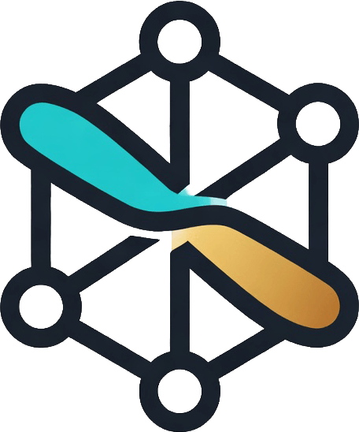
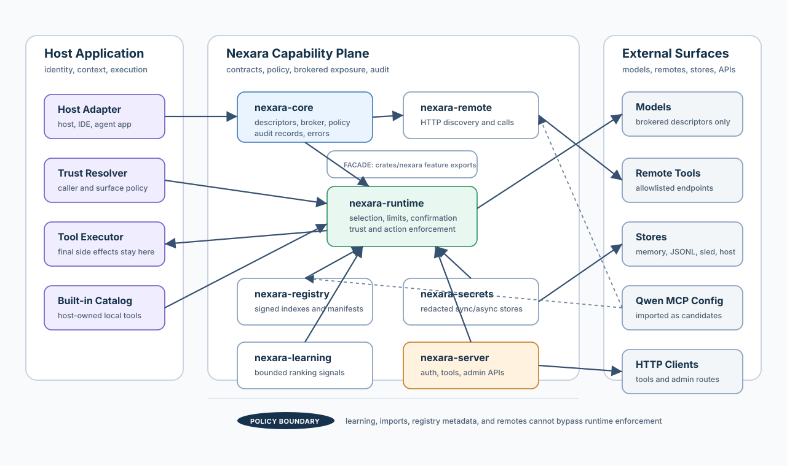

# Nexara

<p align="center">
  
</p>

<p align="center">
  <a href="https://github.com/deliberium/nexara/actions/workflows/ci.yml?query=branch%3Amaster">
    
  </a>
  <a href="https://github.com/deliberium/nexara/blob/master/LICENSE.md">
    
  </a>
</p>

Nexara is the capability layer for AI products that need to use real tools
without turning every integration into a security project. It gives agents and
assistants a signed, policy-aware way to discover skills, rank the right tool,
request secrets, call remote capabilities, and leave behind an audit trail that
hosts can actually trust.

Use Nexara when your AI system is ready to move beyond hard-coded tool lists,
but you still need crisp boundaries around what can be installed, exposed, and
executed.

## What It Provides

- signed skill registries and installable capability packs
- product-neutral `host_requirements` instead of app-specific compatibility fields
- remote tool discovery and execution contracts
- bounded tool selection for model prompts
- trust-tier, scope, action-class, confirmation, payload, and concurrency policy
- sync and async secret-store contracts
- structured audit records with redacted outputs and secret names only
- optional learned usage signals that can improve ranking without overriding policy
- Qwen-family MCP configuration import through `nexara-compat-qwen`
- an authenticated HTTP server with tool and skill-admin APIs

## Architecture



At runtime, the host owns execution and context. Nexara owns the capability
contract: it assembles descriptors, verifies registry metadata, decides what is
visible to the model, enforces policy before calls, and emits audit records.

## Workspace Layout

- `crates/nexara`: facade crate and feature bundle
- `crates/nexara-core`: core tool descriptors, broker, registry, policy, audit, validation, and errors
- `crates/nexara-registry`: signed skill indexes, manifests, installed-skill stores, and file/HTTP sources
- `crates/nexara-secrets`: sync and async secret-store traits, redacted values, memory and encrypted-file stores
- `crates/nexara-remote`: remote endpoint contracts, allowlists, auth providers, diagnostics, and HTTP client helpers
- `crates/nexara-runtime`: host-neutral runtime for policy checks, brokered listing, calls, limits, and audit
- `crates/nexara-learning`: bounded ranking-signal contracts and adjustment engine
- `crates/nexara-learning-memory`: in-memory usage-signal store
- `crates/nexara-learning-jsonl`: append-only local usage-signal store
- `crates/nexara-learning-sled`: embedded durable usage-signal store
- `crates/nexara-compat-qwen`: Qwen-family prompt profile detection and MCP config import
- `crates/nexara-server`: authenticated HTTP service and admin skill install/list APIs
- `sdk/javascript`: small JavaScript client for list/call flows
- `docs`: architecture, deployment, manifest, remote protocol, threat model, and release validation
- `docs/qwen-compatibility.md`: Qwen MCP import and approval-store mapping

## Crate Features

The facade crate keeps the public import surface small while allowing hosts to
avoid unused dependencies.

```toml
[dependencies]
nexara = { version = "0.1", features = ["runtime", "registry", "secrets"] }
```

Available facade features:

- `registry`
- `remote`
- `secrets`
- `runtime`
- `learning`
- `learning-memory`
- `learning-jsonl`
- `learning-sled`
- `compat-qwen`
- `server`
- `all`

## Quick Start

```rust
use async_trait::async_trait;
use nexara_core::{ToolCallRequest, ToolCallResult, ToolDescriptor, TrustProfile};
use nexara_runtime::{
    HostToolExecutor, NexaraRuntime, NexaraRuntimeConfig, StaticToolCatalog,
    StaticTrustPolicyResolver,
};
use serde_json::json;
use std::sync::Arc;

#[derive(Clone)]
struct Context;

struct Executor;

#[async_trait]
impl HostToolExecutor<Context> for Executor {
    async fn call_host_tool(
        &self,
        _tool: &ToolDescriptor,
        request: ToolCallRequest,
        _context: Context,
    ) -> Result<ToolCallResult, nexara_core::NexaraError> {
        Ok(ToolCallResult {
            result: json!({ "echo": request.params }),
        })
    }
}

let tool = ToolDescriptor::read_only("echo", "Echo input for diagnostics");
let runtime = NexaraRuntime::new(
    NexaraRuntimeConfig::default(),
    Arc::new(StaticToolCatalog::new(vec![tool])),
    Arc::new(Executor),
    Arc::new(StaticTrustPolicyResolver::new(TrustProfile::Observe)),
);
```

## Skill Manifests

Nexara manifests use product-neutral host requirements:

```toml
name = "example.search"
version = "0.1.0"
publisher = "example"
description = "Searches an example corpus"
license = "MIT"
runtime = "remote_http"
trust_tier = "community"

[host_requirements]
nexara = ">=0.1.0"
example_app = ">=0.2.0"

[policy]
action_class = "read"
scopes = ["read"]
confirmation = "never"
allowed_hosts = ["https://tools.example.com"]
requires_secrets = ["EXAMPLE_API_KEY"]
```

Legacy app-specific compatibility fields are intentionally not part of the
Nexara schema. Host applications can add their own keys under
`host_requirements` while Nexara keeps the contract reusable.

## HTTP Server

`nexara-server` exposes secure-by-default routes for embedded or standalone use:

- `GET /health`
- `GET /v1/nexara/tools`
- `POST /v1/nexara/tools/call`
- `GET /admin/nexara/skills`
- `POST /admin/nexara/skills/install`

The server owns a default bearer-token middleware and supports development
no-auth only when explicitly configured. Host applications with existing auth
can call the lower-level runtime and registry contracts directly.

## Validation

```bash
cargo fmt --all -- --check
cargo test --workspace
```

For release preparation, see [docs/release-validation.md](docs/release-validation.md).

## Project Status

Nexara `0.1.0` is the first public library surface. The standalone crates,
contracts, docs, examples, and tests are in place for hosts to embed the runtime
or run the authenticated HTTP server.
